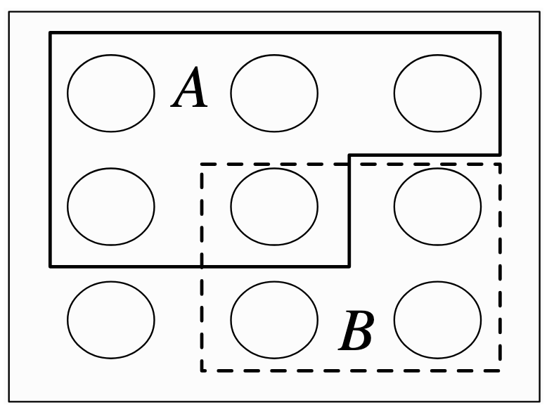
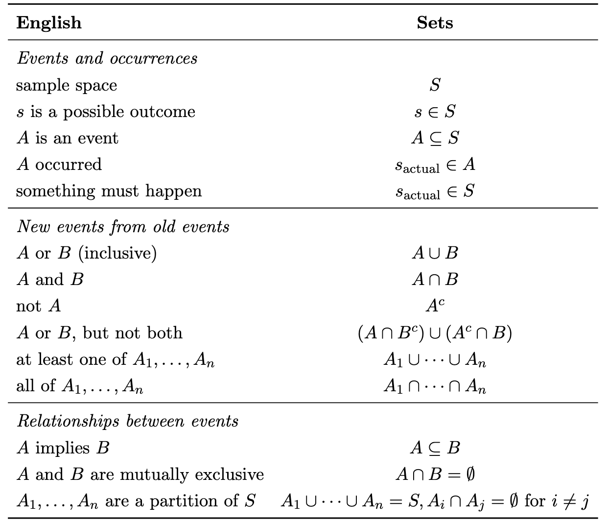
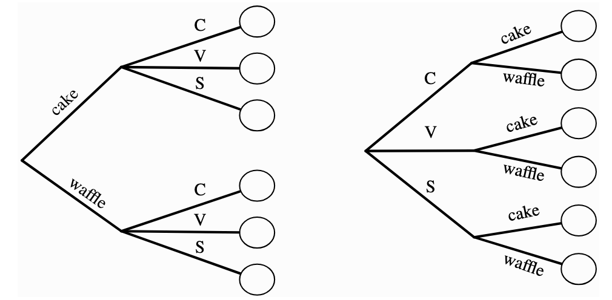
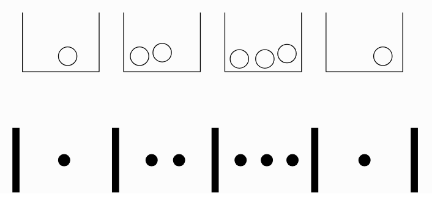
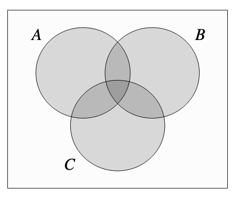
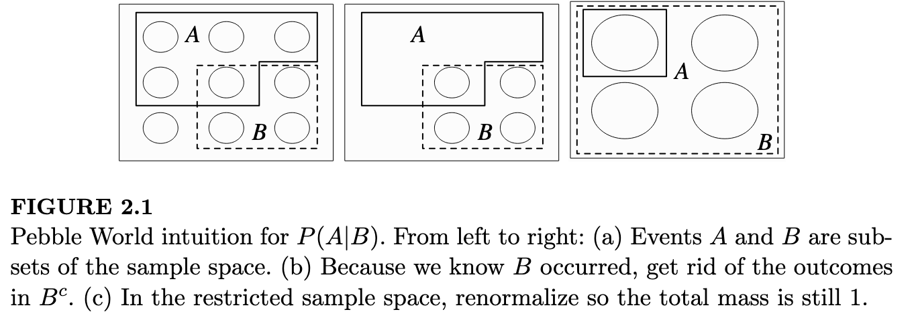

# 0. Some Useful Approaches

-   Label objects even if they seem indistinguishable
-   Adjust for overcounting
-   Is the complement $A^C$ easier to solve for than $A$ directly? Then use the fact that $A^C = 1 - A$
-   Calculate the same thing in alternative ways to verify the answer
-   Check with specific cases – edge cases and the simplest non-trivial case
-   Whenever you see a series of factorials think about Taylor expansions. The two that crop up most are geometric series and $e^x$

# 1. Probability Fundamentals and Set Theory

> Logic is the mathematics of certainty; probability is the mathematics of uncertainty

## 1.1. Set Theory

Concepts from set theory are useful to formalise probability.

The **sample space** $S$ of an experiment is the set of all possible outcomes of the experiment.

An **event** $A$ is a subset of the sample space S, and we say that A occurred if the actual outcome is in A.

{width="254"}

A concise summary of useful set notation:

{width="453"}

## 1.2. Naive Definition of Probability

The earliest definition of probability made some very strong assumptions that *every outcome was equally likely*, so the probability of an event $A$ occurring could be calculated by counting the number of favourable outcomes, i.e.

$$
P_{naive}(A) = \frac{\lvert A \rvert}{\lvert S \rvert}
$$

## 1.3. Multiplication Rule

If we have Experiment A with $A$ possible outcomes, followed by experiment B with \$b\$ possible outcomes, the total number of combinations is $ab$.

This follows intuitively if we consider the **tree diagram**. For example, we choose ice cream cones from one of 3 flavours and one of 2 possible cone types. The total number of possible combinations is $3 \times 2$.

Furthermore, it doesn't matter which order we picked – flavour first or cone first.

{width="396"}

# 2. Counting

## 2.1. Sampling with Replacement, Order Matters

We have $n$ objects and choose $k$ with replacement.

There are $n$ possibilities each time, so this is obviously

$$
N_{outcomes} = n^k
$$

## 2.2. Sampling without Replacement, Order Matters

We have $n$ objects and choose $k$ without replacement.

The are $n$ options for the first choice, then $n-1$ for the second, then $n-2$ for the third... all the way to $n-k+1$ for the kth.

Therefore the result is:

$$
N_{outcomes} = n(n-1)(n-2)...(n-k+1) = \frac{n!}{(n-k)!}
$$

## 2.3. Sampling without Replacement, Order Doesn't Matter

This is essentially the same problem as previously but we have *over-counted*. Now that we don't care about the order, we can say that there \$k!\$ ways of arranging the objects, so we divide by this to correct for the duplicates.

$$
N_{outcomes} = \frac{n!}{(n-k)! k!}
$$

By convention, this is defined as the **binomial coefficient** $n \choose k$ since it crops up so frequently.

## 2.4. Sampling with Replacement, Order Doesn't Matter

This is the least obvious case.

It is equivalent to the **stars and bars** problem. Imagine putting $k$ indistinguishable balls into $n$ distinguishable buckets. We are choosing $k$ objects in total, and those objects can be attributed to one of the $n$ labelled categories.

In the example below, there are $n=4$ buckets and $k=7$ balls.

{width="350"}

The lower picture is an alternative representation. We have $n-1$ bars ($|$) (because the ends are fixed)and $k$ stars ($*$).

Therefore, there are $n+k-1$ "things" choose from, and if we can define the arrangement by fixing the placement of the $k$ stars.

$$
N_{outcomes} = {n+k-1 \choose k}
$$

Note that this is also equivalent to fixing the bars, and by symmetry:

$$
{n+k-1 \choose k} = {n+k-1 \choose n-1}
$$

# 3. Story Proofs 

"Proof by interpretation".

Arrive at the same result in two different ways to prove that the expressions are equivalent.

### Example 1

From $n$ people pick a team of $k$ players. You could either specify the $k$ people on the team or the $n-k$ people not on the team. 

$$
{n \choose k } = {n \choose n-k }
$$

For example, you have 10 people and want to pick 4 for a team. Either pick the 4 players, or the 6 non-players.

### Example 2

From $n$ people pick a team of $k$ players, one of whom is the captain.

$$
n {n-1 \choose k-1} = k {n \choose k}
$$

LHS: Choose the captain first ( $n$ possibilities) then the rest of the team ( $k-1$ players from the remaining population of $n-1$ people)

RHS: Choose the $k$ players first, then pick one of those team members to be captain. 

### Example 3

**Vandermonde’s identity**

We have $m$ men and $n$ women. There are $k$ chairs for them to sit on.

$$
{m+n \choose k} = \sum_{j=0}^k {m \choose j} {n \choose k-j}
$$

LHS: The choice directly. 

RHS: First pick one man, then two men, then three men… then $j$ men. Sum over every value of $j$. 

# 4. The General (Non-Naive) Definition of Probability

## 4.1. Definition

A **probability sample** consists of $S$ and $P$, where $S$ is a sample space and $P$ is a function which takes an event $A \subseteq S$ as input and returns $P(A) \in [0, 1]$ as outputs, such that the following two axioms hold:

Axiom 1: Impossible events have probability 0 and certain events have probability 1.

$P(\emptyset)=0, P(S)=1$

Axiom 2: We can add the probabilities of disjoint events to get their union.

$P(\bigcup_{n=1}^{\inf}) A_n = \sum_{n=1}^{\inf} P(A_n) \text{if} A_1, A_2, ..., A_n \text{are disjoint}$

### Example

**The birthday problem.**

Probability of a shared birthday in a group of n people. 

The intuition: $k$ isn’t the relevant value here. The number of pairs, $k \choose 2$ , is the relevant value because we have that many pairs, each of which could result in a match.

## 4.2. Properties of Probability

The following useful properties follow from the axioms of probability.

### Property 1: Probability of Complement

$P(A^C) = 1 - P(A)$

**Proof:**

Event $A$ and its complement $A^C$ cover the full sample space by definition. From Axiom 1, the probability of the entire sample space is 1.

$P(A \cup A^C) = P(S) = 1$

From Axiom 2, the probability of the union of disjoint sets is the sum of their probabilities.

$P(A \cup A^C) = P(A) + P(A^C)$

Equating the two expressions and rearraging gives the result.

### Property 2: P(A) when A is contained in B

If $A \subseteq B$ then $P(A) \le P(B)$

**Proof:**

An alternative way of writing \$P(B) is as disjoint sets ("disjointification")

$B = A \cup ( B \cap A^C)$\
Since these sets are now disjoint, we can apply Axiom 2:

$$
P(B) = P(A \cup ( B \cap A^C))
     = P(A) + P(B \cap A^C)
$$

Probabilities are always non-negative, so $P(B \cap A^C)$ term is non-negative, therefore $P(B) \ge P(A)$

## 4.3. Inclusion-exclusion

This is another property which follows from the axioms, but is important enough that it warrants specific attention.

Inclusion-exclusion is a formula for finding the probability of a union of events when the **events are not necessarily disjoint**.

### 4.3.1. Two Events

$P(A \cup B) = P(A) + P(B) - P(A \cap B)$

Powerful identity that is useful when finding the probability of a union. 

**Proof:** Start by disjointifying the union.

$P(A \cup B) = P(A \cup (B \cap A^C))$

Now we can apply Axiom 2: $P(A \cup B) = P(A) + P(B \cap A^C)$

We can express $P(B)$ as a union of disjoint sets:

$P(B) = P(B \cap A) + P(B \cap A^C)$

Rearranged this gives: $P(B \cap A^C) = P(B) - P(B \cap A)$

Substitute that into the expression for $P(A \cup B)$ and note that the order of an intersection doesn't matter ($P(B \cap A) = P(A \cap B)$). The result immediately follows.

### 4.3.2. Three Events

The same logic applies to more events. Essentially we add up the areas and subtract the intersections that were double counted.

{width="299"}

For three events $A,B,C$:

$$
P(A \cap B \cap C) = P(A) + P(B) + P(C)
- P(A \cap B) - P(B \cap C) - P(A \cap C)
+ P(A \cap B \cap C)
$$

Intuitively, we are adding up the big circles, then realising we've double counted the oval areas so subtract those two-term areas, then realising that removes the central triangle entirely so add back the three-term area.

### 4.3.3. The General Case

The pattern becomes obvious, so we can write the general case:

$$
P(\bigcup_{i=1}^n A_i) =
\sum_{i=1}^n P(A_i) 
- \sum_{i<j} P(A_i \cap A_j) 
+ \sum_{i<j<k} P(A_i \cap A_j \cap A_k) 
- ...
+ (-1)^{n+1} P(A_1 \cap ... \cap A_n)
$$

### Example

**De Mortmont’s matching problem.**

A problem that can be solved using inclusion-exclusion. 

Whenever you see a series of factorials think about Taylor expansions. The two that crop up most are geometric series and $e^x$. 

# 5. Independence

## 5.1. Definition for Two Variables

Events $A$ and $B$ are independent if:

$P(A \cap B) = P(A)P(B)$

In words, if A occurred it gives no information on whether B occurred. 

Note that independence often gets confused with **disjoint**, but they are almost the opposite. If $A$ and $B$ are disjoint it means that if $A$ occurred then $B$ cannot occur; A occurring gives us complete information over whether B occurred.

> Notation comment: $P(A,B)$ means intersection i.e. $P(A \cap B)$, $A$ and $B$ both occur. 

## 5.2. Definition for Three Variables

For three events $A, B, C$ to be independent, we need pairwise independence and independence of all three together. The former does not imply the latter.

Pairwise independences:

$P(A,B)=P(A)P(B), P(A,C)=P(A)P(C), P(B,C)=P(B)P(C)$

Triple independence:

$P(A,B,C) = P(A)P(B)P(C)$

### Example

**Newton Pepys problem**.

# 6. Conditional Probability

> Conditioning is the soul of statistics

How should you update probabilities given new information?

## 6.1. Definition

$P(A|B) = \frac{P(A \cap B)}{P(B)} \text{, if } P(B)>0$

The intuition from this is obvious from the Venn diagrams (in other words, the pebble world interpretation). If we know $B$ occurred, we re-normalise the probability of $A$ as if $B$ is our sample space.

{width="643"}

## 6.2. Theorems

### Theorem 1: $P(A \cap B)$ expressed two ways

Note that the order of variables in the intersection doesn't matter, it is still the overlap of the Venn diagram. So:

$P(A \cap B) = P(B \cap A)$

Applying the definition of conditional probability to both sides:

$P(A \cap B) = P(B|A)P(A) = P(A|B)P(B)$

### Theorem 2: Intersection of n events

The intersection of $n$ events can be written as the conditionals by recursively applying theorem 1:

$P(A_1, A_2, ..., A_n) = P(A_1)P(A_2|A_1)P(A_3|A_1,A_2)...P(A_n|A_1,...,A_{n-1})$

### Theorem 3: Bayes rule

Rearrange the result from Theorem 1 to get Bayes rule.

This gives us the way to update our posterior given likelihood, prior and evidence.

$P(A|B) = \frac {P(B|A)P(A)}{P(B)}$

# References

-   [Stat 110 Lectures](https://www.youtube.com/playlist?list=PL2SOU6wwxB0uwwH80KTQ6ht66KWxbzTIo)
-   Introduction to Probability - Blitzstein and Hwang